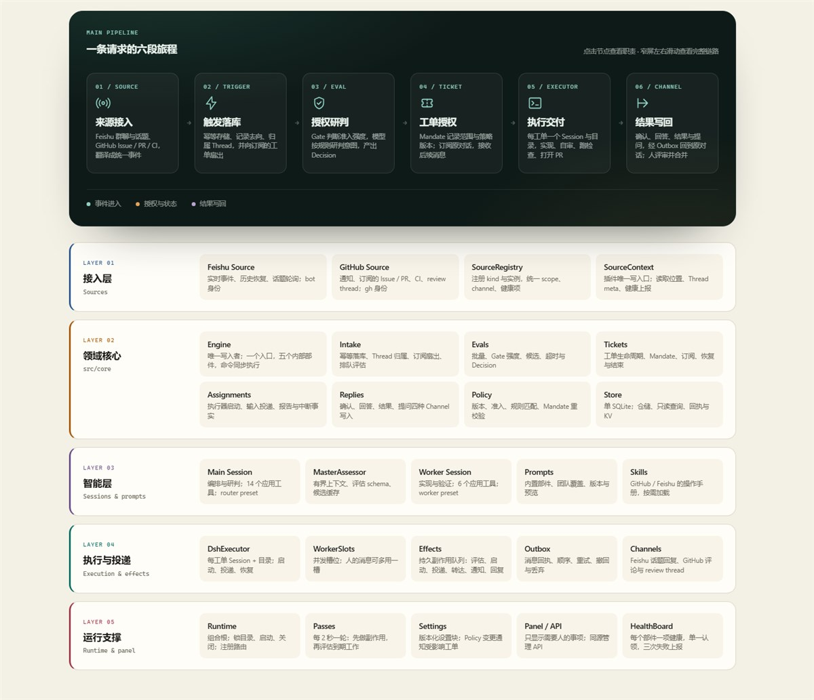
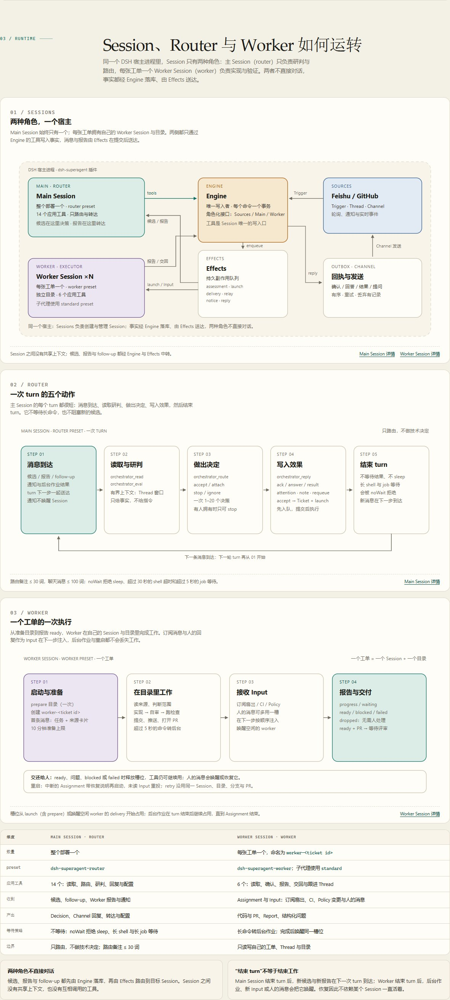

# dsh-superagent-trial

> dsh 超级 agent 的实践仓库

本仓库是 dsh 超级 agent（dsh-superagent）的实践场，不是产品代码。它用来跑通并检验“超级 agent”的工作方式，内容本身可以很小，重点是流程。

## 什么是 dsh 超级 agent

dsh 超级 agent 是构建在 [DeepSeek Harness](https://www.deepseek.com/en/harness/)（DSH）之上的主动式编码 agent，面向单个 GitHub 仓库，也可以接入 Feishu。

- 被允许的人在对话里提出请求后，agent 创建工单，在自己的 agent 会话和目录中完成工作，再回到原对话交付结果——通常是一个 Pull Request。
- 它遵循一条原则：**尽量少占用人的注意力，尽量多交付价值**。只在被请求或团队书面规则允许时行动；只在有结果、需要决策或无法完成时说话。
- 人类负责审阅与合并。agent 的产出先成为可供审阅的 PR，而不是直接进入主分支。

## 架构概览

[docs/architecture-overview.html](docs/architecture-overview.html) 是一页可直接用浏览器打开的可视化架构概览，覆盖来源接入、授权研判、工单执行与结果交付，以及 Session / Router / Worker 的工作循环。页面没有外部依赖，支持浅色与深色主题。

## 在这里实践什么

- 从 IM / GitHub 请求到工单、分支、PR、评审、合并的完整闭环。
- agent 的能力边界：哪些改动可以自主完成，哪些必须由人做出决定。
- 如何用更少的打扰交付结果：确认一次、安静工作、有结果再回复。

## 参与方式

- **Feishu**：在群聊里 @ 机器人，说明具体要改的文案、文档或页面问题。
- **GitHub**：提交 Issue，或在相关 PR 中讨论。
- agent 会创建 PR 供人审阅；合并由人决定，不会自动合入。

## 状态

本仓库属于试验性质，不是官方产品，内容与流程会随实践持续调整。
